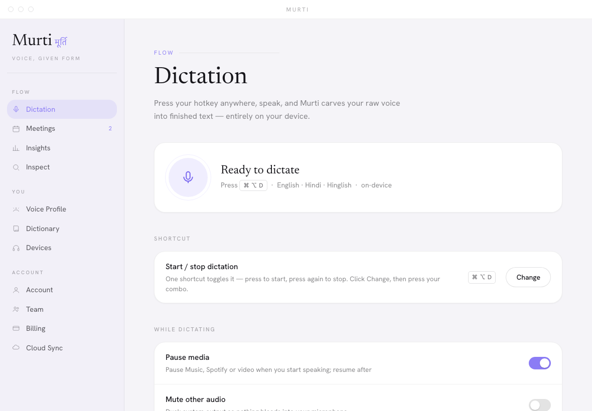

<div align="center">

# Murti · मूर्ति

### Voice, given form.

**Speak anywhere on your Mac. Murti carves your raw voice into finished text —
English, Hindi, and Hinglish — entirely on your device.**
Plus a studio tool that reads any app you own and reveals the form hidden inside it.



<sub>Local Whisper on the Apple Silicon GPU · nothing leaves your machine · built with Claude Code</sub>

</div>

---

## The idea

A *murti* is raw stone given form by a sculptor. **Murti** does the same to your
voice: you speak, and it chisels the messy, half-formed sound into clean, punctuated
text and drops it wherever your cursor is — a message, a doc, an email, your IDE.

No accounts. No upload. The transcription runs **on your device**.

<div align="center">

</div>

## What it does

| | |
|---|---|
| 🎙️ **Dictate anywhere** | Press **⌘⌥D**, speak, press again. It transcribes and types at your cursor in any app. |
| ⌨️ **Your own shortcut** | One toggle starts/stops. Record a custom key combo right in the app — it rebinds instantly, no restart. |
| 🌐 **English · Hindi · Hinglish** | True code-switching. Hindi comes out **romanized (Hinglish)** by default, or Devanagari — your choice. |
| 🧠 **On-device** | Whisper `large-v3-turbo` runs locally on the Apple Silicon GPU. Private and offline. |
| ⏸️ **Pause media while you speak** | Music / Spotify / video auto-pause when you start and resume after. |
| 🔇 **Mute other audio** | Ducks system output so nothing bleeds into your mic. |
| 📖 **Auto-learning dictionary** | Learns the names and jargon you dictate so it spells them right next time. |
| 📈 **Insights & voice profile** | Words dictated, words-per-minute, time saved, streaks — computed locally. |
| 🎧 **Headset & ring support** | Detects headsets and call-control rings, prefers them automatically. |
| 🔎 **Inspect** *(studio)* | Point Murti at any app you own and get its full architecture from the shipped binary. No source code. |
| ☁️ **Cloud, optional** | Meeting notetaker (Zoom), accounts, team, billing and sync are available on top — the dictation core never needs them. |

## How it works

```
 ⌘⌥D  →  record mic (16 kHz)  →  Whisper large-v3-turbo (local, MLX GPU)
                                          │
                                   shape the text
                      ├─ romanize Hindi  (rules offline · Claude online)
                      ├─ translate       (argos offline · Claude online)
                      └─ personal dictionary + corrections
                                          │
                           paste at your cursor (⌘V)
```

Everything in that path is **local by default**. The optional online step (Claude)
only polishes romanization/translation when you have a key — and transcription is
*always* on-device regardless.

The **dashboard** above is served by a tiny `127.0.0.1`-only server
(`murti/dashboard.py`) wired straight to the live engine: the toggles, insights and
your dictionary are the real on-device state, read and written in place.

## Install

### On a MacBook (Apple Silicon) — ✅ supported

You need **macOS 13+ on Apple Silicon** (M1 or later), the
**[`uv`](https://docs.astral.sh/uv/)** package manager, and **Python 3.12**
(uv can fetch Python for you).

**1 — Install `uv`** (skip if you already have it):
```sh
curl -LsSf https://astral.sh/uv/install.sh | sh
```

**2 — Download Murti and set it up:**
```sh
git clone https://github.com/technomad641/murti.git
cd murti
uv venv --python 3.12 .venv
uv pip install -r requirements.txt
```

**3 — Launch it:**
```sh
./run.sh
```
A **🎙️ icon appears in your menu bar** and the Murti window opens.

**4 — Grant three permissions** when macOS prompts (or in **System Settings →
Privacy & Security**), then **quit and relaunch `./run.sh` once** so they apply:
- **Microphone** — to hear you
- **Accessibility** — to type the result into other apps
- **Input Monitoring** — for the global shortcut

You're ready to dictate.

### On an iPhone — ⚠️ not available (yet), and here's the honest why

Murti is **macOS-only**. There is no iPhone app, and it's not a quick add: the
whole point of Murti is typing your voice **into whatever other app you're in**
(Slack, Notes, Safari…), and **iOS does not allow third-party apps to insert text
into other apps** or register a system-wide push-to-talk shortcut. That's an
Apple platform restriction, not a missing feature.

The Apple-sanctioned path on iPhone is a **custom keyboard extension** — you'd
switch to a "Murti" keyboard and tap a mic button inside it. That's a separate
native iOS build (Swift), on the roadmap, not in this repo.

### Prefer to double-click instead of the terminal? Build an app bundle

Once set up, you can wrap Murti into a real **`Murti.app`** you launch from
Finder or the Dock — no terminal, with its own icon:

```sh
scripts/build_app.sh          # builds dist/Murti.app (via py2app)
open dist/Murti.app           # …or just double-click it in Finder
```

This build is **ad-hoc code-signed and de-quarantined**, so it launches on
*your* Mac with no Gatekeeper warning. It's an *alias* build — small and
instant, but tied to this machine (it references your `.venv`).

**To hand Murti to someone else's Mac**, you need a self-contained, **notarized**
bundle. That requires a paid **Apple Developer account** and a *Developer ID
Application* certificate (nothing else can satisfy Gatekeeper on another
machine). With the cert in your keychain:

```sh
scripts/build_app.sh standalone   # self-contained bundle (large)
# store a notary credential once (app-specific password from appleid.apple.com):
xcrun notarytool store-credentials murti-notary \
  --apple-id "you@example.com" --team-id "TEAMID" --password "xxxx-xxxx-xxxx-xxxx"
scripts/sign_notarize.sh          # Developer-ID sign → notarize → staple
```

`scripts/sign_notarize.sh` auto-detects your certificate and tells you exactly
what's missing if the account/cert/Xcode aren't in place yet. (The standalone
freeze of the on-device ML stack is large and may need per-dependency tuning —
do it when you're actually ready to distribute.)

## Using Murti — start, stop, and post your words

**One shortcut toggles dictation — `⌘ ⌥ D` by default.** Press once to **start**,
press again to **stop**.

To **post dictated text into any text block** (a message, a doc, a code editor,
a form field):

1. **Click into the text field** where you want the words — so the cursor is
   blinking there. *(Murti types at your cursor, so this step matters.)*
2. **Press `⌘ ⌥ D`** — the menu-bar icon turns 🔴, Murti is listening.
3. **Speak** your sentence — English, Hindi, or a mix.
4. **Press `⌘ ⌥ D` again** — the icon shows ⏳ while it transcribes on-device…
5. **…and your text appears right where the cursor was.** Done.

> **Example:** Open a Slack message box, click into it, press `⌘ ⌥ D`, say
> *“let’s ship this tomorrow morning,”* press `⌘ ⌥ D` again — the sentence lands
> in the box, ready to send.

**Other ways to start/stop:** the menu-bar **🎙️ → “Start / Stop dictation.”**

**Pick your own shortcut:** open the dashboard (menu-bar 🎙️ → **Show window**) →
**Dictation → Shortcut → Change**, then press your combo (e.g. `⌘ ⇧ Space`). It
rebinds instantly — no restart.

### How “posting” works (under the hood)

When you stop, Murti transcribes locally, copies the finished text to your
clipboard, synthesizes **`⌘ V`** at your cursor, then restores whatever was on
your clipboard before. So it works in **any** app that accepts paste — no per-app
setup needed.

### Permissions recap

Grant these once in **System Settings → Privacy & Security**:
**Microphone** (record) · **Accessibility** (paste at your cursor) ·
**Input Monitoring** (the global shortcut).

### Configure without editing JSON

```sh
./.venv/bin/python -m murti.configure --translate on --target Hindi
./.venv/bin/python -m murti.configure --script devanagari
```

### The Inspect tool

```sh
./.venv/bin/python -m murti.inspect "/Applications/Some App.app"
```

Reads the shipped binary and prints an architecture report (frameworks, native
modules, windows, backend). Structural metadata only — **no source, assets, or
secrets, and nothing that bypasses licensing or DRM.** For apps you own or are
authorized to analyze. Powered by the [REA](https://www.npmjs.com/package/rea-agents)
reverse-engineering engine. (The hero above is a real Inspect run.)

## Tests

```sh
./.venv/bin/python -m pytest tests -q        # 34 offline tests, no mic / no network
```

## Privacy

- **Transcription is on-device.** Your voice is not uploaded for dictation.
- Settings, dictionary and insights live locally in `~/.config/murti/`.
- The dashboard server binds to `127.0.0.1` only.
- Cloud features (meetings, accounts, sync) are opt-in and clearly marked.

## Design

A light, airy interface in the spirit of modern privacy-first products —
**Newsreader** serif headlines over **Hanken Grotesk**, a near-white canvas,
soft-rounded cards floating on diffuse shadows, fully-rounded pill controls, and
a single lavender accent. Built to a disciplined system: two type families, four
colours, an 8-pt grid. The dashboard is a native window (WKWebView) wired to the
local engine, so what you see is live on-device state.

## License

MIT © Rajat Singh — see [LICENSE](LICENSE).

<div align="center"><sub><i>मूर्ति — form, given to the formless.</i></sub></div>
