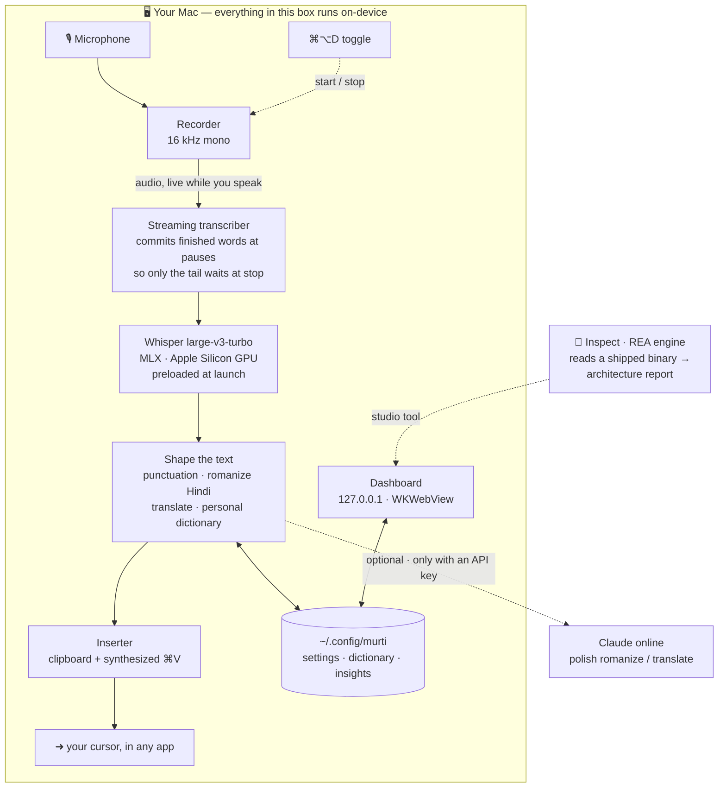

<div align="center">

# Murti · मूर्ति

### Voice, given form.

**Speak anywhere on your Mac. Murti carves your raw voice into finished text —
English, Hindi, and Hinglish — entirely on your device.**
Plus a studio tool that reads any app you own and reveals the form hidden inside it.


[](https://technomad641.github.io/murti/)
[](https://github.com/technomad641/homebrew-murti)


<sub>Local Whisper on the Apple Silicon GPU · nothing leaves your machine · built with Claude Code</sub>

</div>

---

## The idea

A *murti* is raw stone given form by a sculptor. **Murti** does the same to your
voice: you speak, and it chisels the messy, half-formed sound into clean, punctuated
text and drops it wherever your cursor is — a message, a doc, an email, your IDE.

No accounts. No upload. The transcription runs **on your device**.

<div align="center">

</div>

## What it does

| | |
|---|---|
| 🎙️ **Dictate anywhere** | Press **⌘⌥D**, speak, press again. It transcribes and types at your cursor in any app. |
| ⚡ **Instant when you stop** | Murti transcribes *while you speak*, so stopping is near-instant — not a wait that grows with how long you talked. |
| ⌨️ **Your own shortcut** | One toggle starts/stops. Record a custom key combo right in the app — it rebinds instantly, no restart. |
| 🌐 **English · Hindi · Hinglish** | True code-switching. Hindi comes out **romanized (Hinglish)** by default, or Devanagari — your choice. |
| 🧠 **On-device** | Whisper `large-v3-turbo` runs locally on the Apple Silicon GPU. Private and offline. |
| ⏸️ **Pause media while you speak** | Music / Spotify / video auto-pause when you start and resume after. |
| 🔇 **Mute other audio** | Ducks system output so nothing bleeds into your mic. |
| 📖 **Auto-learning dictionary** | Learns the names and jargon you dictate so it spells them right next time. |
| 📈 **Insights & voice profile** | Words dictated, words-per-minute, time saved, streaks — computed locally. |
| 🎧 **Device-aware** | Lists your input devices and flags connected headsets, right in the app. |
| 🔎 **Inspect** *(studio)* | Point Murti at any app you own and get its full architecture from the shipped binary. No source code. |
| ☁️ **Cloud** *(preview)* | Meeting notetaker (Zoom), accounts, team, billing and sync appear in the dashboard as design previews — not yet wired to a backend. The dictation core never needs them. |

## How it works



Two things keep it fast: the model is **preloaded at launch** (no cold start on
your first dictation), and audio is **transcribed as you speak** — finished words
are committed at natural pauses, so when you stop, only the last few seconds
remain. The post-stop wait stays roughly constant instead of growing with the
length of your dictation.

Everything in the box above is **local by default**. The optional online step
(Claude) only polishes romanization/translation when you have a key — and
transcription is *always* on-device regardless. The **dashboard** is served by a
tiny `127.0.0.1`-only server (`murti/dashboard.py`) wired straight to the live
engine, so its toggles, insights and dictionary are the real on-device state.

## Install

### The easy way — Homebrew 🍺

```sh
brew install technomad641/murti/murti
murti
```

Homebrew adds the [tap](https://github.com/technomad641/homebrew-murti)
automatically. The first `murti` launch sets up its environment and downloads
the on-device speech model once (a few minutes); after that it starts instantly.
Then grant the [permissions](#permissions) below and press **⌘⌥D** to dictate.

> Needs up-to-date Xcode Command Line Tools (`xcode-select --install`).
> Update with `brew upgrade murti`, remove with `brew uninstall murti`.

### From source — Apple Silicon

Needs **macOS 13+ on Apple Silicon** (M1+), the
**[`uv`](https://docs.astral.sh/uv/)** package manager, and **Python 3.12**
(uv can fetch it for you).

```sh
# 1 — install uv (skip if you have it)
curl -LsSf https://astral.sh/uv/install.sh | sh

# 2 — get Murti and set it up
git clone https://github.com/technomad641/murti.git
cd murti
uv venv --python 3.12 .venv
uv pip install -r requirements.txt

# 3 — launch it
./run.sh
```

A **🎙️ icon appears in your menu bar** and the Murti window opens. Grant the
[permissions](#permissions) below, relaunch once, and you're ready.

### Permissions

Grant these once in **System Settings → Privacy & Security**, then quit and
relaunch Murti so they take effect:

- **Microphone** — to hear you
- **Accessibility** — to type the result into other apps
- **Input Monitoring** — for the global ⌘⌥D shortcut

### Prefer to double-click? Build an app bundle

Wrap Murti into a real **`Murti.app`** you launch from Finder or the Dock — no
terminal, with its own icon:

```sh
scripts/build_app.sh     # builds dist/Murti.app (via py2app)
open dist/Murti.app      # …or just double-click it in Finder
```

This build is **ad-hoc code-signed and de-quarantined**, so it launches on *your*
Mac with no Gatekeeper warning. It's an *alias* build — small and instant, but
tied to this machine. To hand Murti to **someone else's** Mac you need a
self-contained, **notarized** bundle, which requires a paid **Apple Developer
account** and a *Developer ID Application* certificate:

```sh
scripts/build_app.sh standalone   # self-contained bundle (large)
# store a notary credential once (app-specific password from appleid.apple.com):
xcrun notarytool store-credentials murti-notary \
  --apple-id "you@example.com" --team-id "TEAMID" --password "xxxx-xxxx-xxxx-xxxx"
scripts/sign_notarize.sh          # Developer-ID sign → notarize → staple
```

`scripts/sign_notarize.sh` auto-detects your certificate and tells you exactly
what's missing if the account/cert/Xcode aren't in place.

### On an iPhone — ⚠️ not available (yet)

Murti is **macOS-only**, and iPhone isn't a quick add. Its whole point is typing
your voice **into whatever app you're in**, and **iOS doesn't let third-party
apps insert text into other apps** or register a system-wide push-to-talk
shortcut — an Apple platform restriction, not a missing feature. The sanctioned
path is a **custom keyboard extension** (switch to a "Murti" keyboard, tap a mic
button): a separate native iOS build (Swift), on the roadmap, not in this repo.

## Using Murti — start, stop, and post your words

**One shortcut toggles dictation — `⌘⌥D` by default.** Press to **start**, press
again to **stop**. To post dictated text into any text block:

1. **Click into the text field** so the cursor is blinking there. *(Murti types
   at your cursor.)*
2. **Press `⌘⌥D`** — the menu-bar icon turns 🔴, Murti is listening.
3. **Speak** — English, Hindi, or a mix.
4. **Press `⌘⌥D` again** — a brief ⏳ while it finishes the last words on-device…
5. **…and your text appears right where the cursor was.** Done.

> **Example:** open a Slack box, click into it, press `⌘⌥D`, say *"let's ship this
> tomorrow morning,"* press `⌘⌥D` again — the sentence lands in the box.

**Other ways to start/stop:** the menu-bar **🎙️ → "Start / Stop dictation."**

**Pick your own shortcut:** menu-bar 🎙️ → **Show window** → **Dictation →
Shortcut → Change**, then press your combo (e.g. `⌘⇧Space`). It rebinds instantly.

**How posting works:** Murti copies the finished text to your clipboard,
synthesizes **`⌘V`** at your cursor, then restores your previous clipboard — so it
works in **any** app that accepts paste, with no per-app setup.

## The Inspect tool

```sh
./.venv/bin/python -m murti.inspect "/Applications/Some App.app"
```

Reads the shipped binary and prints an architecture report (frameworks, native
modules, windows, backend). Structural metadata only — **no source, assets, or
secrets, and nothing that bypasses licensing or DRM.** For apps you own or are
authorized to analyze. Powered by the [REA](https://www.npmjs.com/package/rea-agents)
reverse-engineering engine. (The hero image above is a real Inspect run.)

## Configure & test

```sh
# tweak settings without editing JSON (source installs)
./.venv/bin/python -m murti.configure --translate on --target Hindi
./.venv/bin/python -m murti.configure --script devanagari

# 42 offline tests — no mic, no network
./.venv/bin/python -m pytest tests -q
```

## Privacy

- **Transcription is on-device.** Your voice is not uploaded for dictation.
- Settings, dictionary and insights live locally in `~/.config/murti/`.
- The dashboard server binds to `127.0.0.1` only.
- Cloud features (meetings, accounts, sync) are **previews only** — not wired to any backend, so nothing syncs off your device.

## Design

A light, airy interface in the spirit of modern privacy-first products —
**Newsreader** serif headlines over **Hanken Grotesk**, a near-white canvas,
soft-rounded cards on diffuse shadows, pill controls, and a single lavender
accent. Built to a disciplined system: two type families, four colours, an 8-pt
grid. The dashboard is a native window (WKWebView) wired to the local engine, so
what you see is live on-device state.

## License

MIT © Rajat Singh — see [LICENSE](LICENSE).

<div align="center"><sub><i>मूर्ति — form, given to the formless.</i></sub></div>
